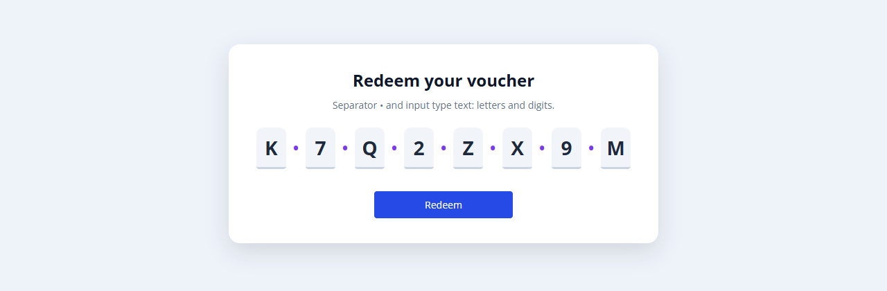

# React OTP

A versatile one-time password input for Mendix. React OTP shows one box per character for OTP, verification and PIN codes: the cursor moves to the next box while typing, Backspace goes back, and a pasted code (or one offered by the phone from an SMS) is spread over the boxes.


## Documentation

- [Marketplace documentation](docs/Marketplace%20Documentation%20-%20React%20OTP.md): install, upgrade, configuration, properties, examples and styling for 2.0.0.
- [React OTP 10.24.17.docx](docs/React%20OTP%2010.24.17.docx): the full guide for version 1.1.0 (settings as attributes). Everything except the property types still applies to 2.0.0.
- [CHANGELOG](reactOTP/CHANGELOG.md)

## Version 2.0.0: settings are expressions

In 2.0.0 every setting except **Value** is an expression. You can type a constant, use an attribute, or write a condition, so you no longer need helper attributes for fixed settings.

| Setting | Type | Examples |
| --- | --- | --- |
| Value | String attribute (unchanged) | `PhoneCode` |
| Number of inputs | Integer expression | `6`, `$currentObject/CodeLength`, `if $currentObject/UsePin then 4 else 6` |
| Input type | String expression | `'number'`, `'password'`, `$currentObject/InputType` |
| Separator | String expression | `'-'`, `' '`, `'•'` |
| Placeholder | String expression | `'0'`, `'123456'` |
| Auto focus | Boolean expression | `true`, `$currentObject/CodeSent` |

Value stays an attribute because the widget writes the code to it.

### Download

- Download `mendix.ReactOTP.mpk` from the release [Version2.0.0](https://github.com/bharathidas/ReactOTP/releases/tag/Version2.0.0) or from the root of this repository.
- Copy it into the `widgets` folder of your app and press **F4** (App > Synchronize App Directory) in Studio Pro.
- Version 1.1.0 (settings as attributes) is in release [Version1.1.0](https://github.com/bharathidas/ReactOTP/releases/tag/Version1.1.0).

### Changes in 2.0.0

- **Breaking:** Number of inputs, Input type, Separator, Placeholder and Auto focus are expressions instead of attributes (Auto focus was a checkbox). See [Upgrading from 1.x](#upgrading-from-1x).
- New widgets start with Number of inputs `4`, Input type `'text'`, Separator `'-'` and Auto focus `false`. Empty, 0 or out-of-range values still fall back to 4 text boxes with `-`.
- Studio Pro design mode shows the number of boxes, the separator and the placeholder when they are constants.
- Studio Pro warns when a constant Number of inputs is outside 1–20, or a constant Input type is not `'text'`, `'number'`, `'tel'` or `'password'`.
- Auto focus now also works when other inputs come before the widget on the page. Before, Mendix moved the focus to the first input of the page right after the widget had focused its first box.
- The settings are in a new **Boxes** group; **Data source** holds only Value.

Tested in a Mendix 10.24.17 app (50 automated checks): all 1.1.0 checks with attribute expressions, plus constants, conditional expressions, wrong constants falling back to the defaults, and auto focus with other inputs on the page. The Studio Pro model check (`mx check`) shows the two warnings for wrong constants and no errors.

### Upgrading from 1.x

1. Replace `mendix.ReactOTP.mpk` in the `widgets` folder of your app with the 2.0.0 file and press **F4**.
2. Studio Pro reports that the widget definition has changed. Right-click the error and choose **Update all widgets**.
3. The property names changed, so **Number of inputs, Input type, Separator, Placeholder and Auto focus are empty** after the update. Open each React OTP widget and enter them again:
   - an attribute you selected before: `$currentObject/<Attribute>`, for example `$currentObject/NumInputs`;
   - a fixed value: the constant, for example `6` or `'number'`;
   - Auto focus that was ticked: `true`.
4. Until you do, the widget uses its defaults: 4 text boxes with `-`, no placeholder and no auto focus. Value, Input class, Container class and the events are kept.

## Version 1.1.0 for Mendix Studio Pro 10.24.17

React OTP 1.1.0 is rebuilt for **Mendix Studio Pro 10.24.17**.

### Download

- Download `mendix.ReactOTP.mpk` 1.1.0 from the release [Version1.1.0](https://github.com/bharathidas/ReactOTP/releases/tag/Version1.1.0).
- The 1.0.0 package is in release [version1](https://github.com/bharathidas/ReactOTP/releases/tag/version1).

### Changes in 1.1.0

- Built with `@mendix/pluggable-widgets-tools` 10.16.0 for Studio Pro 10.24.17 and React 18, as a production build, with react-otp-input 3.1.1. The package is about 12 KB (1.0.0: about 44 KB).
- **Number of inputs**, **Input type** and **Separator** are optional. Without them the widget shows 4 text boxes with `-` between them. In 1.0.0 all three attributes were required.
- An empty Number of inputs attribute (Mendix passes it as 0) shows 4 boxes; in 1.0.0 it showed no boxes. Values outside 1–20 also use 4.
- The input type ignores case and spaces; an unknown value uses `text`.
- Placeholder: one character is shown in every box (for example `0`), a longer text gives one character per box. In 1.0.0 it only worked when its length was exactly the number of boxes.
- When the attribute is read-only (Editability, a read-only data view or access rules) the boxes are disabled. In 1.0.0 they stayed enabled.
- New **On change** and **On complete** actions (On complete runs when every box is filled) and a new **Auto focus** option.
- The first box has `autocomplete="one-time-code"` for SMS code autofill on phones.
- A validation message of the attribute is shown below the boxes.
- The default box style is CSS (`widget-reactotp-input-default`) instead of inline styles: the same look on a desktop, a focus colour, a light placeholder, and smaller boxes on phones so six boxes fit on a 375 px screen (in 1.0.0 they ran off the screen).
- The class, style, tab index and Name set in Studio Pro are applied.
- No debug messages in the browser console.
- Studio Pro design mode shows four boxes. Clearer captions and descriptions. The widget ID and property keys are the same as in 1.0.0, so existing pages keep their settings.

Tested in a Mendix 10.24.17 app (41 automated checks): number of boxes, input types, separator, placeholder, typing, Backspace, arrow keys, paste, letters in a number box, a value changed elsewhere, read-only, On change, On complete, auto focus, custom classes, tab index and a phone-sized window.

### Upgrading from 1.0.0

1. Replace `mendix.ReactOTP.mpk` in the `widgets` folder of your app with the 1.1.0 file.
2. Press **F4** (Synchronize App Directory).
3. Studio Pro reports that the widget definition has changed. Right-click the error and choose **Update all widgets**. Your settings are kept.
4. If the running app still shows the old widget, stop it, choose **App > Clean Deployment Directory** and run it again.

Check after upgrading: if you used Input class or Container class, your class now fully controls the boxes (1.0.0 also set an inline width of 1em on each box), so give the boxes a width in your class.

### Source code and build

The widget source is in the [`reactOTP`](reactOTP) folder.

```
cd reactOTP
npm install
npm run release
```

The package is created in `reactOTP/dist/2.0.0/mendix.ReactOTP.mpk`. Node.js 16 or later is required.

---

## Features (2.0.0)

### •	Value:
The String attribute that holds the code. Required.
### •	Number of inputs:
Integer expression with the number of boxes, 1–20, for example `6` or `$currentObject/CodeLength`. Empty, 0 or out of range uses 4.
### •	Input type:
String expression: `'text'`, `'number'`, `'tel'` or `'password'`. Default is `'text'`. `number` and `tel` accept only digits and show the number keyboard on phones.
### •	Separator:
String expression with the text between the boxes. Default is `'-'`.
### •	Placeholder:
String expression shown in empty boxes: one character for every box (`'0'`), or one character per box (`'123456'`).
### •	Input class:
CSS class for each box; replaces the default box style.
### •	Container class:
CSS class for the row of boxes; replaces the default row style.
### •	Auto focus:
Boolean expression: puts the cursor in the first box when the page opens.
### •	Events:
On change and On complete actions.

## Dependencies:
•	Mendix Studio Pro 10.24.17 or a later 10.24 version (widget 2.0.0 and 1.1.0). Widget 1.0.0: Mendix modeler 9.12.4.

## Issues, suggestions and feature requests
https://github.com/bharathidas/ReactOTP/issues

## Screenshots (version 1.1.0, Mendix 10.24.17)

| | |
| --- | --- |
|  |  |
|  |  |
|  |  |

## Version 1.0.0

Demo of version 1.0.0: https://reactotp-sandbox.mxapps.io/login.html?profile=Responsive


